Este documento detalha o modelo de dados e a arquitetura de comunicação do ecossistema Aura, cobrindo o isolamento multi-tenant (silos), o dicionário de tabelas do Drizzle ORM e os contratos de API do Hono RPC baseados em validações Zod.

---

## 1. Arquitetura Multi-tenant (Silos por Clínica)

Para garantir segurança estrita, conformidade com a LGPD e mitigar contenções de CPU/trava de escrita no SQLite (Cloudflare D1), a Aura adota um modelo de **Multi-tenancy baseado em Silos Isolados**:

- **Isolamento de Tenant**: Cada clínica possui um Worker dedicado e bancos de dados fisicamente separados.
- **CQRS Lite (Segregação de Leitura/Escrita)**:
  - **`D1_MAIN` (OLTP - Operacional)**: Focado em transações de alta frequência (login, agendamentos, prontuários).
  - **`D1_ANALYTICS` (OLAP - Relatórios)**: Focado em consultas pesadas, agregações e paginações de relatórios.
- **Sincronização Assíncrona**: Ocorre via `c.executionCtx.waitUntil()`. Se a replicação para o `D1_ANALYTICS` falhar, os dados da falha são gravados na tabela `sync_fallbacks` do `D1_MAIN` para reconciliação posterior por um Cron Trigger.

```mermaid
sequenceDiagram
    participant Client as Cliente (Frontend)
    participant Worker as Worker (Backend Hono)
    participant D1Main as D1_MAIN (OLTP)
    participant D1Analytics as D1_ANALYTICS (OLAP)

    Client->>Worker: Mutação HTTP (ex: Salvar Agendamento)
    Worker->>D1Main: Gravação Síncrona (Commit)
    D1Main-->>Worker: OK
    Note over Worker: Dispara waitUntil() para Analytics
    Worker-->>Client: Resposta HTTP 200 OK (Interface Liberada)
    
    rect rgb(30, 20, 40)
        Note right of Worker: Execução em Background
        Worker->>D1Analytics: Replicação (Upsert)
        alt Falha na Replicação
            Worker->>D1Main: Gravação em sync_fallbacks
        end
    end
```



---

## 2. Dicionário de Dados (Drizzle ORM)

Os schemas do banco de dados são expressos em TypeScript através do Drizzle ORM e mapeados para tabelas SQLite nativas.

### Tabela: `appointments`
Armazena a agenda operacional de consultas da clínica.

| Campo | Tipo Drizzle | Tipo SQLite | Restrições / Detalhes |
| :--- | :--- | :--- | :--- |
| `id` | `text()` | `TEXT` | Chave Primária (UUID) |
| `patient_name` | `text()` | `TEXT` | Não Nulo |
| `appointment_date` | `integer({ mode: 'timestamp' })` | `INTEGER` | Não Nulo (armazenado como unix epoch millisecond) |
| `status` | `text()` | `TEXT` | Não Nulo (valores comuns: `Pendente`, `Confirmado`, `Cancelado`) |
| `created_at` | `integer({ mode: 'timestamp' })` | `INTEGER` | Não Nulo (data de inserção do registro) |

### Tabela: `sync_fallbacks`
Fila de contingência para registros cuja replicação assíncrona falhou.

| Campo | Tipo Drizzle | Tipo SQLite | Restrições / Detalhes |
| :--- | :--- | :--- | :--- |
| `id` | `text()` | `TEXT` | Chave Primária (UUID) |
| `entity_name` | `text()` | `TEXT` | Não Nulo (ex: `'Appointment'`) |
| `record_id` | `text()` | `TEXT` | Não Nulo (ID do registro que falhou na replicação) |
| `error` | `text()` | `TEXT` | Não Nulo (Stack trace ou mensagem de erro capturada) |
| `created_at` | `integer({ mode: 'timestamp' })` | `INTEGER` | Não Nulo (data do incidente) |

---

## 3. Contratos de API (Hono RPC)

Todos os endpoints da API são tipados e protegidos por isolamento de rotas e domínios via sub-roteadores. Qualquer chamada que viole as regras de domínio (`API_DOMAIN`) ou de caminho de diretório (`/auth` vs `/api`) será rejeitada com código HTTP `403` no middleware correspondente.

### Sub-roteador: `/auth` (Restrito ao caminho `/auth` no `API_DOMAIN`)

Gerencia a autenticação e tokens de sessão. Rejeita tráfego fora do domínio da API ou fora do diretório de autenticação `/auth` com o código de erro **`JQ487`** (ou **`JQ487_PATH`** se o caminho não for correspondente).

#### 1. `POST /auth/login`
- **Payload de Entrada (JSON)**:
  ```json
  {
    "username": "00000000000",
    "password": "senha_plana_secreta"
  }
  ```
  - *Validação Zod (`loginSchema`)*:
    - `username`: CPF válido contendo apenas 11 caracteres numéricos. Caracteres especiais são removidos pelo transform do Zod.
    - `password`: String com no mínimo 6 caracteres.
- **Payload de Saída (Sucesso - 200 OK)**:
  ```json
  {
    "message": "Autenticação bem-sucedida",
    "accessToken": "jwt_token_string",
    "user": {
      "cpf": "00000000000",
      "name": "Nome do Usuário",
      "role": "MEDICO"
    }
  }
  ```
  - *Cookies*: Configura `refreshToken` em cookie HttpOnly, `Secure`, `SameSite=Strict` e com escopo limitado ao caminho `/auth` no domínio da API (`path: "/auth"`).

#### 2. `POST /auth/refresh`
- **Payload de Entrada**:
  - *Cookies (HttpOnly)*: `refreshToken` (Zod `refreshCookieSchema` garante que a string não esteja vazia).
- **Payload de Saída (Sucesso - 200 OK)**:
  - Novo par de `accessToken` no JSON e `refreshToken` nos Cookies rotacionados.

#### 3. `POST /auth/logout`
- **Payload de Entrada**:
  - *Cookies (HttpOnly)*: `refreshToken` para identificar e invalidar a sessão.
- **Payload de Saída (Sucesso - 200 OK)**:
  - JSON confirmando o logoff e cookie de refresh deletado.

---

### Sub-roteador: `/api` (Restrito ao caminho `/api` no `API_DOMAIN`)

Gerencia as operações clínicas do dia a dia. Rejeita acessos fora do domínio da API com o código de erro **`JQ488`**.

#### 1. `GET /api/patients`
- **Descrição**: Retorna a lista de pacientes cadastrados no silo.
- **Payload de Saída (Stub - 200 OK)**:
  ```json
  {
    "status": "success",
    "message": "Patients operational endpoint stub",
    "data": []
  }
  ```

#### 2. `GET /api/agenda`
- **Descrição**: Retorna os agendamentos cadastrados.
- **Payload de Saída (Stub - 200 OK)**:
  ```json
  {
    "status": "success",
    "message": "Agenda operational endpoint stub",
    "data": []
  }
  ```

#### 3. `POST /api/patients` (Esquema de Validação Futuro)
- **Payload de Entrada (JSON)**:
  ```json
  {
    "name": "João da Silva",
    "cpf": "11122233344",
    "birthDate": "1980-05-15"
  }
  ```
  - *Validação Zod (`insertPatientSchema`)*:
    - `name`: No mínimo 3 letras.
    - `cpf`: Exatamente 11 dígitos numéricos.
    - `birthDate`: String no formato `AAAA-MM-DD`.
