Este documento detalha o modelo de dados e a arquitetura de comunicação do ecossistema Aura, cobrindo o isolamento multi-tenant (silos), o dicionário de tabelas do Drizzle ORM e os contratos de API do Hono RPC baseados em validações Zod.

---

## 1. Arquitetura Multi-tenant (Silos por Clínica)

Para garantir segurança estrita, conformidade com a LGPD e mitigar contenções de CPU/trava de escrita no SQLite (Cloudflare D1), a Aura adota um modelo de **Multi-tenancy baseado em Silos Isolados**:

- **Isolamento de Tenant**: Cada clínica possui um Worker dedicado e bancos de dados fisicamente separados.
- **CQRS Lite (Segregação de Leitura/Escrita)**:
  - **`D1_MAIN` (OLTP - Operacional)**: Focado em transações de alta frequência (login, agendamentos, prontuários).
  - **`D1_ANALYTICS` (OLAP - Relatórios)**: Focado em consultas pesadas, agregações e relatórios.
- **Sincronização Assíncrona Eventual**: Ocorre de forma desacoplada via **Cloudflare R2** e **Cron Triggers**:
  - As operações de escrita gravam síncronamente no `D1_MAIN` e salvam o payload de sincronização em formato JSON em um bucket R2 (`SYNC_BUCKET`) sob o prefixo `queue/`.
  - Se a gravação no R2 falhar por erro de rede/plataforma, a falha é registrada na tabela `sync_fallbacks` do `D1_MAIN` para contingência.
  - Um Scheduled Worker (Cron) roda a cada 1 minuto, adquire um lock distribuído temporário no KV (`lock:sync_analytics` com TTL de 5min contra travamentos), processa os payloads do R2 em lotes para otimizar a escrita no `D1_ANALYTICS` e remove os arquivos da fila após o sucesso da sincronização.

```mermaid
sequenceDiagram
    participant Client as Cliente (Frontend)
    participant Worker as Worker (Backend Hono)
    participant D1Main as D1_MAIN (OLTP)
    participant R2 as Cloudflare R2 (SYNC_BUCKET)
    participant Cron as Cron Worker (Scheduled)
    participant D1Analytics as D1_ANALYTICS (OLAP)

    Client->>Worker: Mutação HTTP (ex: Salvar Agendamento)
    Worker->>D1Main: 1. Gravação Síncrona (Commit)
    Worker->>R2: 2. Grava payload JSON (queue/)
    alt Falha na Gravação R2
        Worker->>D1Main: Grava log em sync_fallbacks
    end
    Worker-->>Client: Resposta HTTP 200 OK
    
    rect rgb(30, 20, 40)
        Note over Cron, D1Analytics: Reconciliação (Cron - Eventual)
        Cron->>R2: Lista e lê arquivos JSON pendentes
        Cron->>D1Analytics: Gravação em Lote (Batch Insert)
        Cron->>R2: Deleta arquivos processados de R2
    end
```



---

## 2. Dicionário de Dados (Drizzle ORM)

Os schemas do banco de dados são expressos em TypeScript através do Drizzle ORM e mapeados para tabelas SQLite nativas.

### Tabela: `appointments`
Armazena a agenda operacional de consultas da clínica.

| Campo | Tipo Drizzle | Tipo SQLite | Restrições / Detalhes |
| :--- | :--- | :--- | :--- |
| `id` | `text()` | `TEXT` | Chave Primária (UUID) |
| `patient_name` | `text()` | `TEXT` | Não Nulo |
| `appointment_date` | `integer({ mode: 'timestamp' })` | `INTEGER` | Não Nulo (armazenado como unix epoch millisecond) |
| `status` | `text()` | `TEXT` | Não Nulo (valores comuns: `Pendente`, `Confirmado`, `Cancelado`) |
| `created_at` | `integer({ mode: 'timestamp' })` | `INTEGER` | Não Nulo (data de inserção do registro) |

### Tabela: `sync_fallbacks`
Fila de contingência para registros cuja replicação assíncrona falhou.

| Campo | Tipo Drizzle | Tipo SQLite | Restrições / Detalhes |
| :--- | :--- | :--- | :--- |
| `id` | `text()` | `TEXT` | Chave Primária (UUID) |
| `entity_name` | `text()` | `TEXT` | Não Nulo (ex: `'Appointment'`) |
| `record_id` | `text()` | `TEXT` | Não Nulo (ID do registro que falhou na replicação) |
| `error` | `text()` | `TEXT` | Não Nulo (Stack trace ou mensagem de erro capturada) |
| `created_at` | `integer({ mode: 'timestamp' })` | `INTEGER` | Não Nulo (data do incidente) |

---

## 3. Contratos de API (Hono RPC)

Todos os endpoints da API são tipados e protegidos por isolamento de rotas e domínios via sub-roteadores. Qualquer chamada que viole as regras de domínio (`API_DOMAIN`) ou de caminho de diretório (`/auth` vs `/api`) será rejeitada com código HTTP `403` no middleware correspondente.

### Sub-roteador: `/auth` (Restrito ao caminho `/auth` no `API_DOMAIN`)

Gerencia a autenticação e tokens de sessão. Rejeita tráfego fora do domínio da API ou fora do diretório de autenticação `/auth` com o código de erro **`JQ487`** (ou **`JQ487_PATH`** se o caminho não for correspondente).

#### 1. `POST /auth/login`
- **Payload de Entrada (JSON)**:
  ```json
  {
    "username": "00000000000",
    "password": "senha_plana_secreta"
  }
  ```
  - *Validação Zod (`loginSchema`)*:
    - `username`: CPF válido contendo apenas 11 caracteres numéricos. Caracteres especiais são removidos pelo transform do Zod.
    - `password`: String com no mínimo 6 caracteres.
- **Payload de Saída (Sucesso - 200 OK)**:
  ```json
  {
    "message": "Autenticação bem-sucedida",
    "accessToken": "jwt_token_string",
    "user": {
      "cpf": "00000000000",
      "name": "Nome do Usuário",
      "role": "MEDICO"
    }
  }
  ```
  - *Cookies*: Configura `refreshToken` em cookie HttpOnly, `Secure`, `SameSite=Strict` e com escopo limitado ao caminho `/auth` no domínio da API (`path: "/auth"`).

#### 2. `POST /auth/refresh`
- **Payload de Entrada**:
  - *Cookies (HttpOnly)*: `refreshToken` (Zod `refreshCookieSchema` garante que a string não esteja vazia).
- **Payload de Saída (Sucesso - 200 OK)**:
  - Novo par de `accessToken` no JSON e `refreshToken` nos Cookies rotacionados.

#### 3. `POST /auth/logout`
- **Payload de Entrada**:
  - *Cookies (HttpOnly)*: `refreshToken` para identificar e invalidar a sessão.
- **Payload de Saída (Sucesso - 200 OK)**:
  - JSON confirmando o logoff e cookie de refresh deletado.

---

### Sub-roteador: `/api` (Restrito ao caminho `/api` no `API_DOMAIN`)

Gerencia as operações clínicas do dia a dia. Rejeita acessos fora do domínio da API com o código de erro **`JQ488`**.

#### 1. `GET /api/patients`
- **Descrição**: Retorna a lista de pacientes cadastrados no silo.
- **Payload de Saída (Stub - 200 OK)**:
  ```json
  {
    "status": "success",
    "message": "Patients operational endpoint stub",
    "data": []
  }
  ```

#### 2. `GET /api/agenda`
- **Descrição**: Retorna os agendamentos cadastrados.
- **Payload de Saída (Stub - 200 OK)**:
  ```json
  {
    "status": "success",
    "message": "Agenda operational endpoint stub",
    "data": []
  }
  ```

#### 3. `POST /api/patients` (Esquema de Validação Futuro)
- **Payload de Entrada (JSON)**:
  ```json
  {
    "name": "João da Silva",
    "cpf": "11122233344",
    "birthDate": "1980-05-15"
  }
  ```
  - *Validação Zod (`insertPatientSchema`)*:
    - `name`: No mínimo 3 letras.
    - `cpf`: Exatamente 11 dígitos numéricos.
    - `birthDate`: String no formato `AAAA-MM-DD`.

---

## 4. Diretrizes para Operação Offline e Sincronização Distribuída (Aura Local / LAN)

O status de conexão visível na interface do frontend (ex: "Aura Local", "Aura LAN", "Offline") funciona atualmente como uma **simulação de UI (Mock)**. A arquitetura ativa da Aura é estruturada sob o modelo **Online-First**, no qual todas as operações transacionais de escrita exigem comunicação direta com a borda (Cloudflare D1 Main) para garantir consistência.

Caso o suporte de gravação em ambiente offline (intranet local na clínica ou banco de dados no navegador) seja implementado como requisito funcional ativo, a estrutura de persistência do monorepo deverá ser adaptada seguindo as diretrizes distribuídas abaixo para mitigar o risco de corrupção de dados e colisões de estado (*split-brain*).

### Requisitos Arquiteturais para Replicação Bidirecional

> [!CAUTION]
> **Risco de Corrupção de Dados de Saúde**: Sincronizar bancos de dados desconectados usando upserts simples baseados em IDs sequenciais resulta em colisões violentas de registros de diferentes pacientes e sobrescritas de prontuários. A replicação distribuída de dados clínicos exige integridade referencial estrita e causalidade lógica.

#### 1. Identificadores Únicos Universais (UUID / ULID)
* **Justificativa**: Evita colisão de IDs gerados concorrentemente por dispositivos offline separados.
* **Status**: O esquema atual de `appointments` já utiliza `text('id').primaryKey()` com UUIDv4 no backend, atendendo a este critério. Toda nova tabela adicionada sob este escopo deve seguir este padrão de chave primária string única.

#### 2. Mecanismo de Soft Delete (Tombstones)
* **Justificativa**: Em replicação distribuída, uma deleção física (`DELETE FROM table`) faz com que o registro desapareça sem deixar rastro. Os outros nós do sistema nunca saberão se o registro foi deletado ou se ele nunca existiu, causando ressurreição indesejada de registros.
* **Design**: Deve-se adicionar a coluna `deleted_at` ou `is_deleted` em todas as tabelas clínicas. As exclusões locais devem apenas marcar a flag de deleção. Durante a sincronização, o sincronizador propaga essa flag para o servidor Cloudflare D1 replicar a exclusão.

#### 3. Linhagem Causal e Carimbos de Tempo Lógicos (Lamport Clocks)
* **Justificativa**: Devido ao atraso de rede e relógios desregulados nos computadores locais das clínicas, timestamps físicos convencionais (`Date.now()`) não são confiáveis para determinar a ordem de concorrência das edições.
* **Design**: Adicionar colunas `updated_at` (UTC de alta precisão) e `version` (Logical Clock). Cada edição local incrementa a versão. O sincronizador usa esse vetor de versão para discernir de qual versão ancestral comum a alteração foi gerada.

#### 4. Estratégia de Resolução de Conflitos (Deterministic Last-Write-Wins)
* **Justificativa**: Quando dois nós offline modificam simultaneamente os dados de um agendamento ou prontuário, a nuvem deve resolver a divergência de forma determinística e segura.
* **Design**: 
  * Aplicar Last-Write-Wins (LWW) apenas se a linhagem causal for linear.
  * Em caso de edições concorrentes sobrepostas (divergentes), a alteração do cliente offline deve ser gravada em uma tabela separada de **Conflitos Pendentes de Revisão**, gerando um alerta na interface para a equipe da clínica tomar a decisão clínica de qual registro manter.

#### 5. Replicação de Conteúdo Rico via CRDTs (Conflict-free Replicated Data Types)
* **Justificativa**: Textos longos e dinâmicos (como a evolução clínica em prontuários e receitas) não podem ser mesclados simplesmente escolhendo um dos lados do conflito, sob risco de perda de observações médicas importantes.
* **Design**: Integração de algoritmos baseados em estado ou operações CRDT (como `Yjs` ou `Automerge`). As atualizações offline são salvas como buffers binários de operações diferenciais e mescladas de forma determinística no servidor de borda, preservando o histórico de digitação de ambos os lados sem requerer intervenção manual.

