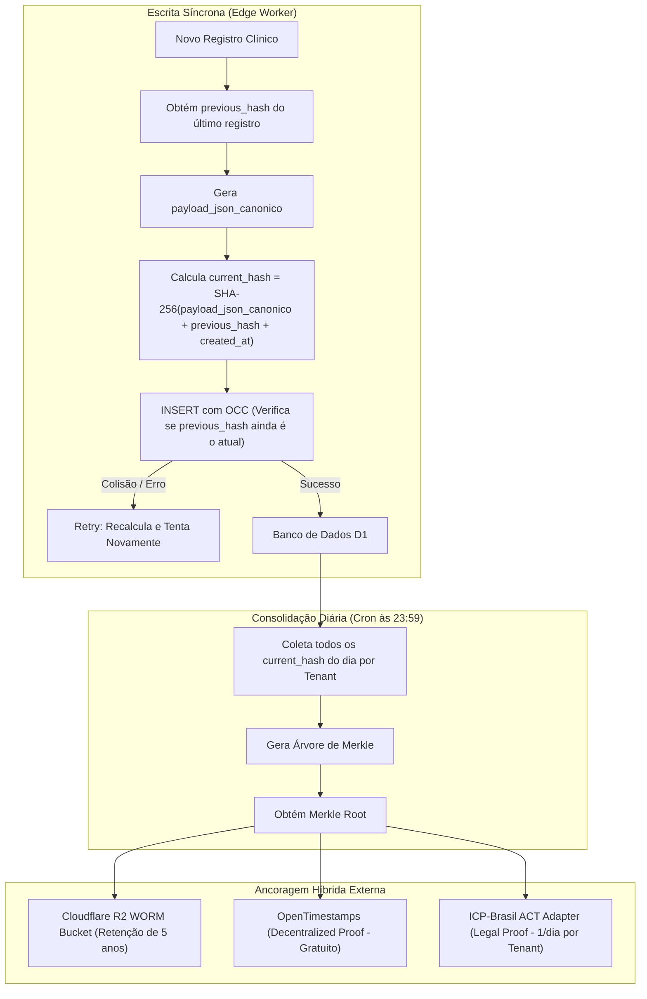
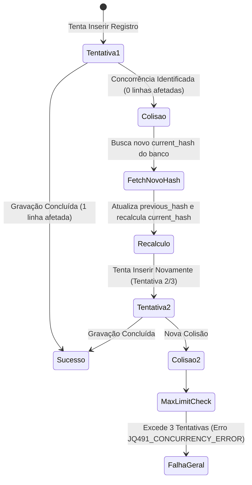

Este documento detalha o modelo de dados e a arquitetura de comunicação do ecossistema Aura, cobrindo o isolamento multi-tenant (silos), o dicionário de tabelas do Drizzle ORM e os contratos de API do Hono RPC baseados em validações Zod.

---

## 1. Arquitetura Multi-tenant (Silos por Clínica)

Para garantir segurança estrita, conformidade com a LGPD e mitigar contenções de CPU/trava de escrita no SQLite (Cloudflare D1), a Aura adota um modelo de **Multi-tenancy baseado em Silos Isolados**:

- **Isolamento de Tenant**: Cada clínica possui um Worker dedicado e bancos de dados fisicamente separados.
- **CQRS Lite (Segregação de Leitura/Escrita)**:
  - **`D1_MAIN` (OLTP - Operacional)**: Focado em transações de alta frequência (login, agendamentos, prontuários).
  - **`D1_ANALYTICS` (OLAP - Relatórios)**: Focado em consultas pesadas, agregações e relatórios.
- Um Scheduled Worker (Cron) roda a cada 1 minuto, adquire um lock distribuído temporário no KV (`lock:sync_analytics` com TTL de 5min contra travamentos) e executa a reconciliação eventual unificada e deduplicada:
  1. **Unificação de Fontes com Controle de Lote**: Busca concorrentemente os registros da tabela `sync_fallbacks` (banco de dados operacional `D1_MAIN`) e os arquivos JSON de mutação pendentes na fila do R2 (`SYNC_BUCKET/queue/`). Para evitar estouro de memória (Out-of-Memory / OOM), o Cron limita o processamento a um lote máximo de 500 a 1000 referências por execução, utilizando paginação via cursor (`continuationToken`) na API `LIST` do R2 e a cláusula `LIMIT` na consulta SQL ao `D1_MAIN`.
  2. **Mapeamento e Ordenação Cronológica**: Consolida todas as referências em uma lista única de referências de eventos (`EventRef`), mapeando o timestamp de criação, ID do registro e nome da entidade, e ordena-os de forma estritamente cronológica.
  3. **Agrupamento e Deduplicação**: Agrupa os eventos por entidade exclusiva (`entityName:recordId`). Para cada entidade, identifica apenas o estado mais recente (`latestRef`) a ser processado.
  4. **Execução do Estado Final (Defesa LWW)**:
     - Se o estado mais recente for do tipo `R2`, lê o payload correspondente e aplica o upsert no banco analítico (`D1_ANALYTICS`).
     - Se for do tipo `Fallback`, lê o estado atual direto do banco operacional (`D1_MAIN`) e faz o upsert no banco analítico. Nessa etapa, o `SELECT` no `D1_MAIN` deve obrigatoriamente ignorar filtros lógicos da aplicação (como `deleted_at IS NULL` ou equivalentes), capturando a fotografia bruta do registro mesmo se ele estiver excluído logicamente (soft delete), propagando com precisão a exclusão/tombstone para o banco secundário.
     - *Defesa Condicional Last-Write-Wins (LWW)*: Todos os upserts no `D1_ANALYTICS` devem ser estritamente condicionais. A instrução de gravação deve conter uma cláusula garantindo que a linha só será sobrescrita se a data de atualização ou timestamp do evento entrante for estritamente maior que a versão já salva no banco de destino. Eventos atrasados ou entregues fora de ordem (*Out-of-Order Delivery*) são descartados silenciosamente, prevenindo regressão de dados.
  5. **Exclusão Idempotente**: Se o processamento do estado final for bem-sucedido, o Cron executa a **exclusão idempotente** de todos os logs no banco operacional e arquivos temporários associados àquele grupo no R2. Em caso de oscilações de rede que impeçam a deleção de algum arquivo no R2 (deixando arquivos 'fantasmas' órfãos), as execuções futuras do Cron tentarão reprocessá-los. Porém, a defesa condicional LWW (Passo 4) irá rejeitar a gravação repetida no banco analítico, permitindo que a rotina apenas conclua a tentativa de deleção do arquivo de forma segura e sem efeitos colaterais. Se falhar no processamento, todas as referências são mantidas para nova tentativa.

```mermaid
sequenceDiagram
    participant Client as Cliente (Frontend)
    participant Worker as Worker (Backend Hono)
    participant D1Main as D1_MAIN (OLTP)
    participant R2 as Cloudflare R2 (SYNC_BUCKET)
    participant Cron as Cron Worker (Scheduled)
    participant D1Analytics as D1_ANALYTICS (OLAP)

    Client->>Worker: Mutação HTTP (ex: Salvar Agendamento)
    Worker->>D1Main: 1. Gravação Síncrona (Commit)
    Worker->>R2: 2. Grava payload JSON (queue/)
    alt Falha na Gravação R2
        Worker->>D1Main: Grava log em sync_fallbacks
    end
    Worker-->>Client: Resposta HTTP 200 OK
    
    rect rgb(30, 20, 40)
        Note over Cron, D1Analytics: Reconciliação Unificada (Cron - Eventual)
        Cron->>D1Main: 1. SELECT na tabela sync_fallbacks
        Cron->>R2: 2. LIST arquivos em queue/
        Note over Cron: Consolida, ordena e agrupa por Entidade
        Note over Cron: Identifica o último estado (latestRef) do grupo
        alt O último estado é R2
            Cron->>R2: GET arquivo JSON (último)
            Cron->>D1Analytics: Grava estado final (Upsert)
        else O último estado é Fallback
            Cron->>D1Main: SELECT foto atual do registro
            Cron->>D1Analytics: Grava estado final (Upsert)
        end
        Note over Cron: Sucesso no processamento do grupo
        Cron->>D1Main: DELETE todos os fallbacks do grupo
        Cron->>R2: DELETE todos os arquivos JSON do grupo
    end
```



---

## 2. Dicionário de Dados (Drizzle ORM)

Os schemas do banco de dados são expressos em TypeScript através do Drizzle ORM e mapeados para tabelas SQLite nativas.

### Tabela: `appointments`
Armazena a agenda operacional de consultas da clínica.

| Campo | Tipo Drizzle | Tipo SQLite | Restrições / Detalhes |
| :--- | :--- | :--- | :--- |
| `id` | `text()` | `TEXT` | Chave Primária (UUID) |
| `patient_name` | `text()` | `TEXT` | Não Nulo |
| `appointment_date` | `integer({ mode: 'timestamp' })` | `INTEGER` | Não Nulo (armazenado como unix epoch millisecond) |
| `status` | `text()` | `TEXT` | Não Nulo (valores comuns: `Pendente`, `Confirmado`, `Cancelado`) |
| `created_at` | `integer({ mode: 'timestamp' })` | `INTEGER` | Não Nulo (data de inserção do registro) |

### Tabela: `sync_fallbacks`
Fila de contingência para registros cuja replicação assíncrona falhou.

| Campo | Tipo Drizzle | Tipo SQLite | Restrições / Detalhes |
| :--- | :--- | :--- | :--- |
| `id` | `text()` | `TEXT` | Chave Primária (UUID) |
| `entity_name` | `text()` | `TEXT` | Não Nulo (ex: `'Appointment'`) |
| `record_id` | `text()` | `TEXT` | Não Nulo (ID do registro que falhou na replicação) |
| `error` | `text()` | `TEXT` | Não Nulo (Stack trace ou mensagem de erro capturada) |
| `created_at` | `integer({ mode: 'timestamp' })` | `INTEGER` | Não Nulo (data do incidente) |

### Tabela: `prescriptions` (Aura Pulso)
Registros de receitas médicas emitidas.

| Campo | Tipo Drizzle | Tipo SQLite | Restrições / Detalhes |
| :--- | :--- | :--- | :--- |
| `id` | `text()` | `TEXT` | Chave Primária (UUID) |
| `tenant_id` | `text()` | `TEXT` | Não Nulo (identificador do silo/clínica) |
| `doctor_cpf` | `text()` | `TEXT` | Não Nulo (CPF do médico emissor) |
| `patient_name` | `text()` | `TEXT` | Não Nulo (nome do paciente) |
| `patient_cpf` | `text()` | `TEXT` | Não Nulo (CPF do paciente) |
| `content` | `text()` | `TEXT` | Não Nulo (JSON de itens e posologias) |
| `previous_hash` | `text()` | `TEXT` | Não Nulo (hash da linha anterior do mesmo silo) |
| `current_hash` | `text()` | `TEXT` | Não Nulo (hash SHA-256 da linha atual) |
| `created_at` | `integer({ mode: 'timestamp' })` | `INTEGER` | Não Nulo (data de criação) |

### Tabela: `prescription_validity_logs` (Aura Pulso)
Logs históricos de status de validade e controle das receitas.

| Campo | Tipo Drizzle | Tipo SQLite | Restrições / Detalhes |
| :--- | :--- | :--- | :--- |
| `id` | `text()` | `TEXT` | Chave Primária (UUID) |
| `tenant_id` | `text()` | `TEXT` | Não Nulo (identificador do silo/clínica) |
| `prescription_id` | `text()` | `TEXT` | Não Nulo (chave estrangeira de `prescriptions`) |
| `status` | `text()` | `TEXT` | Não Nulo (valores comuns: `ATIVO`, `REVOGADO`, `EXPIRADO`) |
| `previous_hash` | `text()` | `TEXT` | Não Nulo (hash da linha anterior do log de validade) |
| `current_hash` | `text()` | `TEXT` | Não Nulo (hash SHA-256 da linha atual) |
| `created_at` | `integer({ mode: 'timestamp' })` | `INTEGER` | Não Nulo (data do evento) |

### Tabela: `clinical_evolutions` (Aura Fluxo)
Evoluções médicas e anotações clínicas do paciente no prontuário eletrônico.

| Campo | Tipo Drizzle | Tipo SQLite | Restrições / Detalhes |
| :--- | :--- | :--- | :--- |
| `id` | `text()` | `TEXT` | Chave Primária (UUID) |
| `tenant_id` | `text()` | `TEXT` | Não Nulo (identificador do silo/clínica) |
| `patient_id` | `text()` | `TEXT` | Não Nulo (chave estrangeira do paciente) |
| `doctor_cpf` | `text()` | `TEXT` | Não Nulo (CPF do médico autor) |
| `notes` | `text()` | `TEXT` | Não Nulo (texto clínico da evolução) |
| `previous_hash` | `text()` | `TEXT` | Não Nulo (hash da linha anterior de evolução deste paciente) |
| `current_hash` | `text()` | `TEXT` | Não Nulo (hash SHA-256 da linha atual) |
| `created_at` | `integer({ mode: 'timestamp' })` | `INTEGER` | Não Nulo (data de inserção da evolução) |

---

## 3. Contratos de API (Hono RPC)

Todos os endpoints da API são tipados e protegidos por isolamento de caminhos e validação de origem. Requisições que violem as regras de CORS ou tentem acessar rotas fora do escopo do roteador Hono correspondente serão bloqueadas com códigos HTTP `403`.

### Sub-roteador: `/auth` (Restrito ao caminho `/auth/*` da API)

Gerencia a autenticação e tokens de sessão. Rejeita tráfego cujo caminho de acesso lógico não corresponda a `/auth/*` com o código de erro **`JQ487_PATH`** (Caminho de Autenticação Inválido).

#### 1. `POST /auth/login`
- **Payload de Entrada (JSON)**:
  ```json
  {
    "username": "00000000000",
    "password": "senha_plana_secreta"
  }
  ```
  - *Validação Zod (`loginSchema`)*:
    - `username`: CPF válido contendo apenas 11 caracteres numéricos. Caracteres especiais são removidos pelo transform do Zod.
    - `password`: String com no mínimo 6 caracteres.
- **Payload de Saída (Sucesso - 200 OK)**:
  ```json
  {
    "message": "Autenticação bem-sucedida",
    "accessToken": "jwt_token_string",
    "user": {
      "cpf": "00000000000",
      "name": "Nome do Usuário",
      "role": "MEDICO"
    }
  }
  ```
  - *Cookies*: Configura `refreshToken` em cookie HttpOnly, `Secure`, `SameSite=Strict` e com escopo limitado ao caminho `/auth` (`path: "/auth"`).

#### 2. `POST /auth/refresh`
- **Payload de Entrada**:
  - *Cookies (HttpOnly)*: `refreshToken` (Zod `refreshCookieSchema` garante que a string não esteja vazia).
- **Payload de Saída (Sucesso - 200 OK)**:
  - Novo par de `accessToken` no JSON e `refreshToken` nos Cookies rotacionados.

#### 3. `POST /auth/logout`
- **Payload de Entrada**:
  - *Cookies (HttpOnly)*: `refreshToken` para identificar e invalidar a sessão.
- **Payload de Saída (Sucesso - 200 OK)**:
  - JSON confirmando o logoff e cookie de refresh deletado.

---

### Sub-roteador: `/api` (Restrito ao caminho `/api/*` da API)

Gerencia as operações clínicas do dia a dia. Rejeita requisições cross-origin não permitidas (CORS origin inválido) com o código de erro **`JQ488`** (Origem Não Permitida) ou caminhos operacionais incorretos com **`JQ488_PATH`**.

#### 1. `GET /api/patients`
- **Descrição**: Retorna a lista de pacientes cadastrados no silo.
- **Payload de Saída (Stub - 200 OK)**:
  ```json
  {
    "status": "success",
    "message": "Patients operational endpoint stub",
    "data": []
  }
  ```

#### 2. `GET /api/agenda`
- **Descrição**: Retorna os agendamentos cadastrados.
- **Payload de Saída (Stub - 200 OK)**:
  ```json
  {
    "status": "success",
    "message": "Agenda operational endpoint stub",
    "data": []
  }
  ```

#### 3. `POST /api/patients` (Esquema de Validação Futuro)
- **Payload de Entrada (JSON)**:
  ```json
  {
    "name": "João da Silva",
    "cpf": "11122233344",
    "birthDate": "1980-05-15"
  }
  ```
  - *Validação Zod (`insertPatientSchema`)*:
    - `name`: No mínimo 3 letras.
    - `cpf`: Exatamente 11 dígitos numéricos.
    - `birthDate`: String no formato `AAAA-MM-DD`.

---

## 4. Diretrizes para Operação Offline e Sincronização Distribuída (Aura Local / LAN)

O status de conexão visível na interface do frontend (ex: "Aura Local", "Aura LAN", "Offline") funciona atualmente como uma **simulação de UI (Mock)**. A arquitetura ativa da Aura é estruturada sob o modelo **Online-First**, no qual todas as operações transacionais de escrita exigem comunicação direta com a borda (Cloudflare D1 Main) para garantir consistência.

Caso o suporte de gravação em ambiente offline (intranet local na clínica ou banco de dados no navegador) seja implementado como requisito funcional ativo, a estrutura de persistência do monorepo deverá ser adaptada seguindo as diretrizes distribuídas abaixo para mitigar o risco de corrupção de dados e colisões de estado (*split-brain*).

### Requisitos Arquiteturais para Replicação Bidirecional

> [!CAUTION]
> **Risco de Corrupção de Dados de Saúde**: Sincronizar bancos de dados desconectados usando upserts simples baseados em IDs sequenciais resulta em colisões violentas de registros de diferentes pacientes e sobrescritas de prontuários. A replicação distribuída de dados clínicos exige integridade referencial estrita e causalidade lógica.

#### 1. Identificadores Únicos Universais (UUID / ULID)
* **Justificativa**: Evita colisão de IDs gerados concorrentemente por dispositivos offline separados.
* **Status**: O esquema atual de `appointments` já utiliza `text('id').primaryKey()` com UUIDv4 no backend, atendendo a este critério. Toda nova tabela adicionada sob este escopo deve seguir este padrão de chave primária string única.

#### 2. Mecanismo de Soft Delete (Tombstones)
* **Justificativa**: Em replicação distribuída, uma deleção física (`DELETE FROM table`) faz com que o registro desapareça sem deixar rastro. Os outros nós do sistema nunca saberão se o registro foi deletado ou se ele nunca existiu, causando ressurreição indesejada de registros.
* **Design**: Deve-se adicionar a coluna `deleted_at` ou `is_deleted` em todas as tabelas clínicas. As exclusões locais devem apenas marcar a flag de deleção. Durante a sincronização, o sincronizador propaga essa flag para o servidor Cloudflare D1 replicar a exclusão.

#### 3. Linhagem Causal e Carimbos de Tempo Lógicos (Lamport Clocks)
* **Justificativa**: Devido ao atraso de rede e relógios desregulados nos computadores locais das clínicas, timestamps físicos convencionais (`Date.now()`) não são confiáveis para determinar a ordem de concorrência das edições.
* **Design**: Adicionar colunas `updated_at` (UTC de alta precisão) e `version` (Logical Clock). Cada edição local incrementa a versão. O sincronizador usa esse vetor de versão para discernir de qual versão ancestral comum a alteração foi gerada.

#### 4. Estratégia de Resolução de Conflitos (Deterministic Last-Write-Wins)
* **Justificativa**: Quando dois nós offline modificam simultaneamente os dados de uma entidade mutável (como um agendamento), a nuvem deve resolver a divergência de forma determinística e segura.
* **Design**: 
  * Aplicar Last-Write-Wins (LWW) apenas se a linhagem causal for linear.
  * Em caso de edições concorrentes sobrepostas (divergentes), a alteração do cliente offline deve ser gravada em uma tabela separada de **Conflitos Pendentes de Revisão**, gerando um alerta na interface para a equipe da clínica tomar a decisão administrativa de qual registro manter.

#### 5. Imutabilidade Legal do Prontuário e Estratégia Append-Only (Adição Contínua)
* **Justificativa**: Conforme a regulamentação do CFM (Conselho Federal de Medicina) e do padrão de Certificação de Prontuários (SBIS/CFM), o prontuário eletrônico do paciente (PEP) é um documento médico legal **imutável**. O uso de algoritmos de mesclagem automática de texto (como CRDTs - Yjs/Automerge) caractere por caractere em textos médicos introduz um risco clínico inaceitável. Por exemplo, se um médico digitar offline "Não administrar dipirona" e outro editar o mesmo bloco para "Administrar dipirona", uma mescla de texto automatizada pode corromper o texto clínico de forma perigosa e ilegível.
* **Design**: 
  * **Proibição de Mesclagem de Texto (No CRDT Merge)**: Sob nenhuma circunstância textos médicos conflitantes ou edições paralelas em prontuários e receitas médicas podem ser mesclados algoritmicamente.
  * **Fluxo Append-Only (Adição Contínua)**: Não existe operação de `UPDATE` sobre a evolução clínica de prontuários salvos. Qualquer alteração ou correção pós-salvamento deve ser registrada exclusivamente como um **Adendo** ou **Retificação** em um novo bloco.
  * **Resolução de Conflitos Offline**: Em caso de escritas concorrentes offline no mesmo prontuário, o sistema de sincronização deve anexar ambas as versões integralmente como registros independentes e separados, contendo carimbos de data/hora (timestamps), identificação de autoria (CRM e assinatura digital do médico correspondente) e metadados distintos. A interpretação clínica das evoluções conflitantes cabe estritamente à equipe médica.
  * **Campos Mutáveis Permitidos**: Apenas campos de controle de assinatura digital (como status de assinatura e o payload de metadados da assinatura ICP-Brasil) podem sofrer alterações pontuais e transições de estado, nunca o corpo clínico textual.

---

## 5. Garantia de Imutabilidade e Ledger Criptográfico

Para garantir conformidade legal com a legislação brasileira de prontuários eletrônicos (PEP) e fornecer provas matemáticas contra adulteração direta no banco de dados (tamper-evidence), o ecossistema Aura implementa um **Ledger Criptográfico** de ponta a ponta. 

A arquitetura de imutabilidade é dividida em duas camadas: **Hash Chain interna** (encadeamento síncrono em banco de dados) e **Ancoragem externa** (consolidação assíncrona diária com carimbo de tempo ICP-Brasil e Blockchain).

> [!IMPORTANT]
> **Restrição de Escopo Clínico-Legal**:
> Por motivos de otimização de concorrência e custo, o Ledger Criptográfico é aplicado **estritamente** às tabelas de relevância médico-legal: `prescriptions` e `prescription_validity_logs` (Aura Pulso) e `clinical_evolutions` (Aura Fluxo). Tabelas administrativas ou mutáveis (como `appointments`) não participam do encadeamento para evitar gargalos de IO no SQLite.



### 1. Mecânica da Hash Chain Interna

Cada registro inserido em uma tabela sob o Ledger Criptográfico deve obrigatoriamente se vincular à linha anterior através de uma corrente de hashes (*Hash Chain*), impedindo qualquer tentativa de reordenação, inserção retrospectiva ou remoção silenciosa de registros médicos.

* **previous_hash (TEXT)**: Contém o `current_hash` do registro anterior correspondente àquele escopo (ex: mesmo `tenant_id` ou mesmo `tenant_id` + `patient_id` para evoluções clínicas). Para o primeiro registro do escopo (gênese), o valor deve ser preenchido com uma string constante de zeros (`0000000000000000000000000000000000000000000000000000000000000000`).
* **current_hash (TEXT)**: Representa o hash criptográfico calculado para a linha atual.

#### Algoritmo de Hashing na Borda
A geração do hash é feita de forma síncrona pelo Cloudflare Worker antes do commit no banco D1, utilizando a Web Crypto API nativa do runtime da Cloudflare (`crypto.subtle.digest`):

> **Fórmula de Geração de Hash:**
> `current_hash = SHA-256(payload_json_canonico + previous_hash + created_at)`

1. **payload_json_canonico**: O JSON correspondente ao conteúdo médico e metadados da linha (como ID, CPF do médico e conteúdo textual) passa por uma função de canonicidade. O ecossistema adota uma abordagem recursiva nativa (`deepSortObject`) para garantir a ordenação de chaves em todos os níveis e sub-objetos aninhados de forma determinística, sem depender de bibliotecas externas no V8 Isolate.
2. **previous_hash**: O hash da linha anterior do encadeamento.
3. **created_at**: Timestamp Unix em milissegundos da criação do registro.

```typescript
// Função auxiliar recursiva para ordenação profunda das chaves
function deepSortObject(obj: any): any {
  if (obj === null || typeof obj !== "object") {
    return obj;
  }
  if (Array.isArray(obj)) {
    return obj.map(deepSortObject);
  }
  const sortedKeys = Object.keys(obj).sort();
  const result: Record<string, any> = {};
  for (const key of sortedKeys) {
    result[key] = deepSortObject(obj[key]);
  }
  return result;
}

// Exemplo de cálculo de Hash Criptográfico na Borda (Edge Worker)
async function calculateRowHash(
  payload: Record<string, any>,
  previousHash: string,
  createdAt: number
): Promise<string> {
  // 1. Canonicidade do JSON (ordenação recursiva profunda das chaves)
  const canonicalPayload = JSON.stringify(deepSortObject(payload));
  
  // 2. Concatenação dos componentes
  const inputString = `${canonicalPayload}|${previousHash}|${createdAt}`;
  const encoder = new TextEncoder();
  const data = encoder.encode(inputString);
  
  // 3. Hashing usando a Web Crypto API (nativo e cloud-agnostic)
  const hashBuffer = await crypto.subtle.digest("SHA-256", data);
  
  // 4. Conversão para representação hexadecimal
  const hashArray = Array.from(new Uint8Array(hashBuffer));
  return hashArray.map(b => b.toString(16).padStart(2, "0")).join("");
}
```

---

### 2. Controle de Concorrência Otimista (OCC)

Como o SQLite/D1 opera com escritas distribuídas globais através dos Workers da borda, existe o risco de dois Workers tentarem criar novos registros simultaneamente para o mesmo paciente ou clínica. Se ambos lerem o mesmo `previous_hash` inicial, ocorreria uma bifurcação (*fork*) na corrente de hashes, quebrando a linearidade.

Para evitar isso, a inserção é feita com **Controle de Concorrência Otimista (OCC)** diretamente no comando de escrita:

1. **Inserção Condicional**: A query SQL de inserção realiza uma verificação atômica de que o `previous_hash` fornecido na inserção ainda é o `current_hash` do registro mais recente daquela cadeia no banco de dados.
2. **Exemplo de Expressão SQL**:
   ```sql
   INSERT INTO prescriptions (id, tenant_id, doctor_cpf, patient_name, patient_cpf, content, previous_hash, current_hash, created_at)
   SELECT :id, :tenant_id, :doctor_cpf, :patient_name, :patient_cpf, :content, :previous_hash, :current_hash, :created_at
   WHERE (
     -- Verifica se o último registro cadastrado possui o current_hash igual ao previous_hash enviado
     SELECT current_hash FROM prescriptions 
     WHERE tenant_id = :tenant_id 
     ORDER BY created_at DESC LIMIT 1
   ) = :previous_hash
   OR (
     -- Permite a inserção caso seja o primeiro registro (tabela/cadeia vazia)
     SELECT COUNT(*) FROM prescriptions WHERE tenant_id = :tenant_id
   ) = 0;
   ```

#### Fluxo de Retentativas do Worker
Se o banco de dados retornar que nenhuma linha foi inserida (indicando colisão de concorrência), o Cloudflare Worker intercepta a resposta e realiza o seguinte fluxo automático:



1. Efetua um `SELECT` para obter o novo `current_hash` da linha mais recente.
2. Atualiza o valor de `previous_hash` para o novo hash obtido.
3. Atualiza o timestamp `created_at` para o horário atual.
4. Recalcula o `current_hash` do novo bloco.
5. Executa novamente o `INSERT` condicional.
6. O processo se repete por até **3 tentativas**. Se persistir a colisão, retorna um erro HTTP `409 Conflict` com o código **`JQ491_CONCURRENCY_ERROR`**.

---

### 3. Consolidação Diária via Árvore de Merkle

Para congelar e resumir todas as transações de um determinado dia em uma única prova matemática portátil, a Aura adota a consolidação diária baseada em **Árvores de Merkle** (*Merkle Trees*).

1. **Cron Trigger (Diário às 23:59)**: Um worker agendado varre o banco de dados de cada tenant buscando todos os registros das tabelas protegidas (`prescriptions`, `prescription_validity_logs`, `clinical_evolutions`) inseridos nas últimas 24 horas.
2. **Geração das Folhas**: Os valores de `current_hash` de cada registro daquele dia são ordenados cronologicamente e servem como nós folha da árvore de Merkle.
3. **Cálculo da Raiz (Merkle Root)**: Os nós são agrupados em pares e hashados sucessivamente (H(A + B)) até que reste apenas uma única hash final: a **Raiz de Merkle (Merkle Root)**.

> **Fórmula da Raiz de Merkle:**
> `Merkle Root = SHA-256(Sub-Árvore Esquerda + Sub-Árvore Direita)`

A Raiz de Merkle funciona como um lacre de segurança. Qualquer adulteração em qualquer registro do dia invalida a raiz calculada.

---

### 4. Ancoragem Híbrida Externa

Uma vez gerada a Raiz de Merkle diária de cada silo de cliente (tenant), a integridade precisa ser atestada externamente para garantir que nem mesmo um administrador com privilégios totais na infraestrutura do banco de dados Cloudflare D1 consiga alterar o histórico sem deixar rastros. A Aura utiliza uma estratégia de **Ancoragem Híbrida**:

#### A. Ancoragem Técnica (R2 WORM Bucket)
* **Destino**: O JSON contendo a estrutura completa da Árvore de Merkle (folhas, ramos e a raiz) é salvo em um bucket do **Cloudflare R2**.
* **Política WORM (Write Once, Read Many)**: Este bucket R2 possui uma política estrita de retenção habilitada por objeto. Arquivos gravados na pasta de consolidação diária não podem ser deletados ou sobrescritos por nenhum usuário, API ou credencial por um período regulamentar de **5 anos**.

#### B. Ancoragem Legal (OpenTimestamps + ICP-Brasil ACT)
Para atestar juridicamente a data de existência da Raiz de Merkle e das transações associadas, a raiz é submetida a duas redes de carimbo de tempo:

1. **OpenTimestamps (Blockchain Pública - Custo Zero)**: A Raiz de Merkle é submetida de forma gratuita ao protocolo OpenTimestamps, que insere o hash na rede do Bitcoin. Isso garante uma prova matemática de existência temporal irrefutável e descentralizada em escala global.
2. **ICP-Brasil (Autoridade de Carimbo de Tempo - Conformidade Legal)**: A raiz também é enviada para uma Autoridade de Carimbo de Tempo (ACT) credenciada ao padrão ICP-Brasil (infraestrutura de chaves públicas brasileira), que retorna um token de carimbo de tempo assinado digitalmente com a hora oficial do país (Hora de Brasília).
3. **Otimização de Custos Transacionais**: As requisições de carimbos de tempo sob o padrão ICP-Brasil são cobradas por chamada. Se o sistema carimbasse cada receita ou prontuário gerado individualmente, o custo operacional seria proibitivo. Ao agrupar todos os registros do dia em uma Árvore de Merkle e carimbar **apenas a Raiz de Merkle consolidada (exatamente 1 chamada ICP-Brasil por tenant por dia)**, a Aura garante conformidade jurídica total para milhares de registros médicos diários a um custo fixo de centenas de vezes menor.


