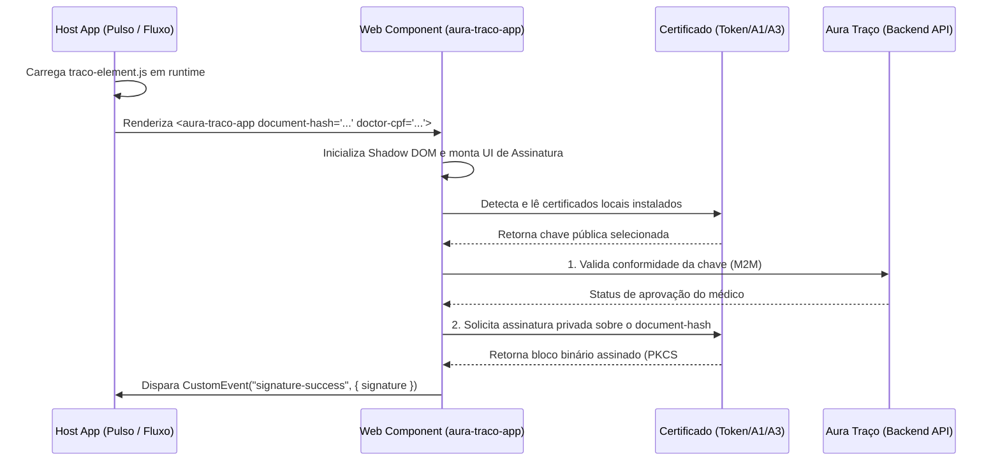

O **Aura Traço** é o microsserviço especializado do ecossistema Aura dedicado a gerenciar a criptografia de chaves, comunicação com certificados digitais (A1 e A3 via WebPKI/extensões de navegador) e a geração de assinaturas regulatórias no padrão ICP-Brasil.

Aura Traço é uma aplicação puramente **integrada e utilitária**. Ela não possui:
- Acesso autônomo (*Standalone Mode*) direto para usuários finais.
- Interface de login própria (toda a autenticação é resolvida via tokens M2M temporários ou herdados).
- Rotas lógicas administrativas de navegação.

Toda a sua operação depende de ser instanciada dentro de um fluxo hospedeiro (como o **Aura Pulso** ou **Aura Fluxo**), que fornece o contexto clínico e o documento a ser assinado.

---

## 1. Topologia e Portas

* **Script Bundle Frontend (Web Component)**: `http://traco.localhost:12501/assets/traco-element.js`
* **Backend API**: `traco-api.localhost:12502`
* **CORS**: Configurado de forma restrita para aceitar requisições de origem do Pulso e do Fluxo.

---

## 2. Arquitetura de Integração do Frontend (Web Component / Micro-framework)

Para garantir que atualizações nos drivers de WebPKI, suporte a novos tokens criptográficos (A3) ou cadeias de certificação da ICP-Brasil não exijam atualizações de código ou novos deploys no Fluxo e Pulso, a interface do Aura Traço é distribuída e consumida em tempo de execução (*runtime*) via **Custom Elements**.



### 1. Definição do Web Component no Aura Traço

No repositório `apps/traco-frontend`, a aplicação compila um Custom Element contendo toda a lógica de comunicação com extensões WebPKI e gerenciadores locais de chaves:

```typescript
// Exemplo de montagem do Web Component do Aura Traço
import React from 'react';
import ReactDOM from 'react-dom/client';
import AssinaturaApp from './AssinaturaApp';

class AuraTracoAppElement extends HTMLElement {
  private root: ReactDOM.Root | null = null;

  // Escuta alterações nos dados criptográficos e de contexto clínico
  static get observedAttributes() {
    return ['tenant-id', 'doctor-cpf', 'doctor-crm', 'doctor-crm-uf', 'document-hash', 'access-token'];
  }

  connectedCallback() {
    const shadow = this.attachShadow({ mode: 'open' });
    const container = document.createElement('div');
    container.id = 'traco-root';
    
    // Importa o arquivo de estilos encapsulados do Traço
    const styleLink = document.createElement('link');
    styleLink.rel = 'stylesheet';
    styleLink.href = 'http://traco.localhost:12501/assets/style.css';
    
    shadow.appendChild(styleLink);
    shadow.appendChild(container);

    this.root = ReactDOM.createRoot(container);
    this.renderReact();
  }

  attributeChangedCallback(name: string, oldValue: string, newValue: string) {
    if (oldValue !== newValue && this.root) {
      this.renderReact();
    }
  }

  disconnectedCallback() {
    if (this.root) {
      this.root.unmount();
    }
  }

  private renderReact() {
    const tenantId = this.getAttribute('tenant-id') || '';
    const doctorCpf = this.getAttribute('doctor-cpf') || '';
    const doctorCrm = this.getAttribute('doctor-crm') || '';
    const doctorCrmUf = this.getAttribute('doctor-crm-uf') || '';
    const documentHash = this.getAttribute('document-hash') || '';
    const accessToken = this.getAttribute('access-token') || '';

    this.root?.render(
      <React.StrictMode>
        <AssinaturaApp
          tenantId={tenantId}
          doctorCpf={doctorCpf}
          doctorCrm={doctorCrm}
          doctorCrmUf={doctorCrmUf}
          documentHash={documentHash}
          accessToken={accessToken}
          onSuccess={(signature) => {
            // Emite o bloco binário PKCS#7 da assinatura
            this.dispatchEvent(new CustomEvent('signature-success', {
              detail: { signature },
              bubbles: true,
              composed: true
            }));
          }}
          onError={(error) => {
            this.dispatchEvent(new CustomEvent('signature-failed', {
              detail: { error },
              bubbles: true,
              composed: true
            }));
          }}
        />
      </React.StrictMode>
    );
  }
}

if (!customElements.get('aura-traco-app')) {
  customElements.define('aura-traco-app', AuraTracoAppElement);
}
```

### 2. Consumo no Aplicativo Hospedeiro (Aura Pulso / Aura Fluxo)

A aplicação chamadora simplesmente carrega o script e exibe o modal ou painel de assinatura de forma declarativa:

```typescript
import React, { useEffect, useState } from 'react';

export function PainelAssinaturaMedica({ documentHash, doctorInfo, tenantId, userToken }) {
  const [signatureResult, setSignatureResult] = useState<string | null>(null);

  useEffect(() => {
    // Injeta dinamicamente o script de micro-frontend do Traço
    const scriptId = 'aura-traco-script';
    if (!document.getElementById(scriptId)) {
      const script = document.createElement('script');
      script.id = scriptId;
      script.type = 'module';
      script.src = 'http://traco.localhost:12501/assets/traco-element.js';
      document.body.appendChild(script);
    }
  }, []);

  useEffect(() => {
    const element = document.querySelector('aura-traco-app');

    const handleSuccess = (event: any) => {
      const signature = event.detail.signature;
      setSignatureResult(signature);
      // Próximo passo: submeter o envelope da assinatura para a API de validade (Pulso/Fluxo)
    };

    const handleFailed = (event: any) => {
      console.error(`Erro ao assinar digitalmente: ${event.detail.error}`);
    };

    element?.addEventListener('signature-success', handleSuccess);
    element?.addEventListener('signature-failed', handleFailed);

    return () => {
      element?.removeEventListener('signature-success', handleSuccess);
      element?.removeEventListener('signature-failed', handleFailed);
    };
  }, []);

  return (
    <div className="card-signature">
      <h3>Assinatura de Documento Clínico</h3>
      <aura-traco-app
        tenant-id={tenantId}
        doctor-cpf={doctorInfo.cpf}
        doctor-crm={doctorInfo.crm}
        doctor-crm-uf={doctorInfo.crmUf}
        document-hash={documentHash}
        access-token={userToken}
      />
    </div>
  );
}
```

---

## 3. Segurança e Isolamento

* **CSS Encapsulado**: O uso de `attachShadow({ mode: 'open' })` impede vazamento de estilos das páginas hospedeiras (como fontes do sistema hospitalar, tabelas CSS ou resets globais) para dentro da interface do Traço. Isso garante que a lista de seleção de certificados e a tela de confirmação de senha do cartão inteligente (PIN) apareçam de forma perfeitamente legível em qualquer dispositivo.
* **Isolamento de Origem M2M**: Embora o script rode no navegador da clínica, a API do backend do Aura Traço (`traco-api.localhost:12502`) exige que o cabeçalho `Authorization: Bearer` carregue uma assinatura de token M2M válida do ecossistema Aura, permitindo chamadas apenas a partir de contextos validados.
