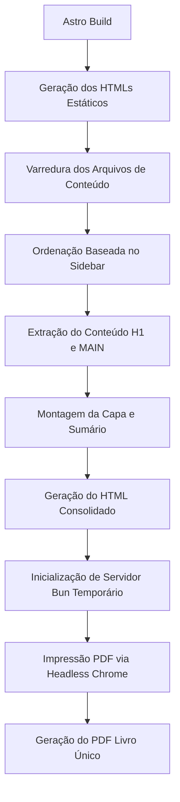

Este documento descreve o funcionamento do compilador e gerador de PDFs para as documentações da Aura (**DevSpecs** e **Central de Ajuda**). O sistema foi concebido para ser leve, independente de dependências pesadas do Node.js, e em total conformidade com os princípios da arquitetura *Cloud Agnostic*.

---

## 1. Arquitetura do Compilador

Como o Astro/Starlight compila as páginas de conteúdo em arquivos HTML estáticos isolados, a geração de um PDF único e consolidado exige um compilador customizado. O script `scripts/generate-pdf.ts` realiza essa compilação seguindo as seguintes etapas:



### 1.1 Extração Semântica e Coesão
Para manter o design limpo e focado no conteúdo, o script lê os arquivos gerados no diretório `dist/` de cada projeto e utiliza expressões regulares otimizadas para:
* Extrair apenas a tag principal `<main>` contendo o artigo de documentação, ignorando sidebars, caixas de busca, cabeçalhos de navegação e botões interativos do portal web.
* Extrair os títulos das páginas a partir da tag `<title>` para povoar dinamicamente o Sumário.
* Coletar e injetar todas as folhas de estilo CSS originais (`<link rel="stylesheet">`) da compilação inicial, garantindo o visual e o realce de sintaxe de blocos de código idênticos aos da web.

---

## 2. Sumário Dinâmico e Paginação Consecutiva

A numeração de páginas em PDFs gerados a partir de páginas web múltiplas costuma ser um desafio. Contornamos isso convertendo a documentação em um único arquivo HTML consolidado (`consolidated-book.html`) antes de enviá-lo ao Chrome.

### 2.1 Âncoras e Sumário Clicável
Cada capítulo recebe um ID exclusivo (`#chapter-N`). O Sumário gera links tradicionais `<a href="#chapter-N">`. Durante a geração do PDF, o motor do Google Chrome traduz essas âncoras HTML em **links internos funcionais no arquivo PDF**.

### 2.2 CSS Paged Media (`target-counter`)
Para exibir dinamicamente o número correto da página para cada capítulo no Sumário, utilizamos propriedades CSS avançadas de paginação suportadas nativamente pelo Chrome:

```css
.book-toc .toc-link::after {
  content: target-counter(attr(href), page);
  font-weight: 500;
  color: #3f3f46;
}
```

Isso instrui o motor de renderização a rastrear a âncora e substituir o conteúdo visual pela numeração física da página onde o elemento alvo foi renderizado.

### 2.3 Cabeçalhos e Rodapés Consecutivos
Durante a geração, chamamos o Chrome no modo headless com o recurso `--display-header-footer` e configuramos templates HTML inline para exibir:
* **Cabeçalho**: Título do livro à direita.
* **Rodapé**: A numeração contínua e formatada: `Página <span class="pageNumber"></span> de <span class="totalPages"></span>`.

---

## 3. Guia de Uso

### 3.1 Geração Local
Para limpar compilações antigas e gerar os novos documentos PDF consolidados, execute no diretório raiz do monorepo:

```bash
bun run pdf:docs
```

Os PDFs finais consolidados serão gravados nas seguintes subpastas de exportação:
* `pdf-exports/internal/internal-docs-consolidated.pdf`
* `pdf-exports/manual/user-manual-consolidated.pdf`

### 3.2 Estrutura de Limpeza e Ignoração
* A cada execução, a pasta `pdf-exports/` é completamente deletada e recriada, evitando arquivos obsoletos.
* A pasta `pdf-exports/` está configurada no `.gitignore` global para evitar o versionamento de arquivos binários pesados no Git.
