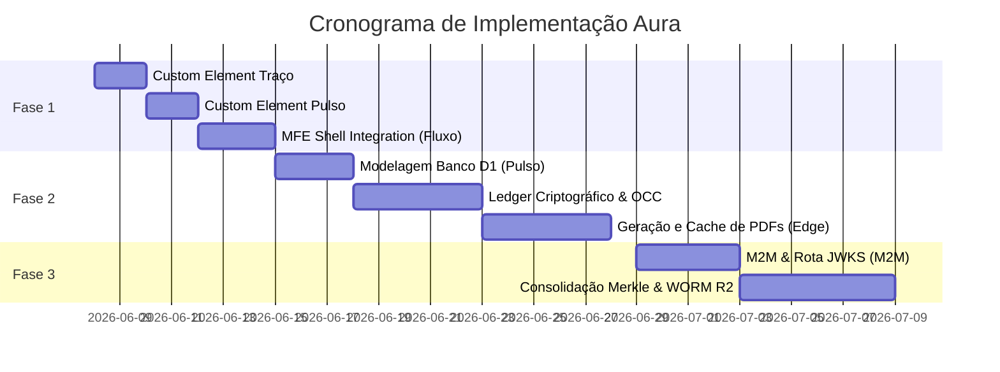

Este documento detalha o planejamento de engenharia contendo a ordem cronológica sugerida e a especificação das tarefas necessárias para levar o ecossistema **Aura** do estágio atual (com stubs operacionais) para a conformidade total de produção.

---

## 1. Fase 1: Padronização de Micro-frontends (MFEs)
**Objetivo**: Envelopar os frontends restantes sob o mesmo padrão de Custom Elements com isolamento de estilos Shadow DOM utilizado no Aura Caso.

### Tarefa 1.1: Implementar Custom Element do Aura Traço
* **Escopo**:
  - Modificar [main.tsx](file:///home/lumen/aura/apps/traco-frontend/src/main.tsx) para expor a classe `AuraTracoAppElement` que estende `HTMLElement`.
  - Injetar o encapsulamento de estilos via link CSS dinâmico e montar o aplicativo React via `ReactDOM.createRoot`.
  - Registrar a tag `<aura-traco-app>`.
* **Complexidade**: Baixa.

### Tarefa 1.2: Implementar Custom Element do Aura Pulso
* **Escopo**:
  - Modificar [main.tsx](file:///home/lumen/aura/apps/pulso-frontend/src/main.tsx) para registrar a classe `AuraPulsoAppElement` sob o elemento customizado `<aura-pulso-app>`.
* **Complexidade**: Baixa.

### Tarefa 1.3: Integração dos Componentes MFE no Aura Fluxo Shell
* **Escopo**:
  - Atualizar o aplicativo [App.tsx](file:///home/lumen/aura/apps/fluxo-frontend/src/App.tsx) do Fluxo para consumir de forma nativa e em tempo de execução os Custom Elements `<aura-caso-app>`, `<aura-pulso-app>` e `<aura-traco-app>`.
  - Remover referências a mocks manuais no dashboard e estruturar o ciclo de vida do carregamento dos scripts na inicialização da página.
* **Complexidade**: Média.

---

## 2. Fase 2: Implementação da API Operacional do Aura Pulso
**Objetivo**: Estruturar o banco de dados operacional, o ledger criptográfico e a geração na borda de documentos PDF.

### Tarefa 2.1: Modelagem do Banco D1 do Aura Pulso
* **Escopo**:
  - Criar `apps/pulso-backend/src/db/schema.ts` mapeando as tabelas `prescriptions` (contendo `previous_hash` e `current_hash` obrigatórios), `prescription_items` e `prescription_validity_logs`.
  - Configurar migrações D1 para provisionamento em produção.
* **Complexidade**: Média.

### Tarefa 2.2: Algoritmo de Ledger Criptográfico
* **Escopo**:
  - Implementar a função `calculateRowHash` e a lógica recursiva `deepSortObject` no backend do Pulso para garantir a imutabilidade das receitas médicas.
  - Implementar controle de concorrência otimista (OCC) na inserção de receitas de forma a impedir *forks* da Hash Chain na borda (Edge Worker).
* **Complexidade**: Alta (Exige testes unitários rigorosos de concorrência e hashes).

### Tarefa 2.3: Cache de Templates e Geração de PDF via pdf-lib
* **Escopo**:
  - Implementar o preenchimento de campos de receitas médicas no nó de borda utilizando a biblioteca `pdf-lib`.
  - Configurar o cache dos arquivos PDF base no Cloudflare KV Namespace e cache local via Cache API nativa (`caches.default`) para eliminar a latência de leitura no Cloudflare R2 durante a emissão.
* **Complexidade**: Alta.

---

## 3. Fase 3: Validade de Assinaturas e Automação Legal (Aura Traço)
**Objetivo**: Integrar o backend do Aura Traço com chaves ICP-Brasil e automações diárias do Ledger.

### Tarefa 3.1: Validação de Tokens M2M e Rota JWKS no Pulso
* **Escopo**:
  - Habilitar o endpoint `GET /auth/jwks` no Aura Pulso para publicação de chaves públicas dinâmicas de assinatura.
  - Atualizar a autenticação do Aura Fluxo para consumir e validar o JWKS do Pulso, permitindo a verificação de claims estruturadas (`doctor_cpf`, `tenant_id`) de forma stateless.
* **Complexidade**: Alta.

### Tarefa 3.2: Consolidação Diária e Árvore de Merkle
* **Escopo**:
  - Implementar o Scheduled Worker (Cron) executado às 23:59 em cada microsserviço para consolidar todas as transações do dia em uma única Árvore de Merkle.
  - Automatizar a persistência da estrutura Merkle no Cloudflare R2 WORM (retenção por 5 anos) e submeter o Merkle Root ao protocolo OpenTimestamps (blockchain) e ACT (ICP-Brasil).
* **Complexidade**: Alta.

---

## 4. Ordem Cronológica de Execução Recomendada

