Este documento detalha o ecossistema de autenticação e a topologia de tokens adotada na Aura para garantir segurança contra roubo de sessão (XSS/CSRF), isolamento completo de cookies via diretiva `Path` no protocolo HTTP e a mecânica de atualização silenciosa de tokens no frontend de três aplicações completamente autônomas: **Aura Fluxo**, **Aura Traço** e **Aura Pulso**.

---

## 1. Topologia de Domínios e Sistemas Autônomos

O ecossistema Aura é composto por três aplicações autônomas e fisicamente isoladas:
1. **Aura Fluxo** (Gestão Clínica)
2. **Aura Traço** (Assinatura Digital)
3. **Aura Pulso** (Emissão de Receitas)

Cada aplicação possui sua própria base de persistência de dados (D1), seu próprio frontend e seu próprio backend unificado, o qual responde de forma agregada tanto pelas rotas operacionais (`/api/*`) quanto pelas rotas de identidade (`/auth/*`).

| Aplicação | Domínio Frontend | Domínio API Backend (Cross-Origin) |
| :--- | :--- | :--- |
| **Aura Fluxo** | `fluxo.clinicaexemplo.com.br` | `fluxo-api.clinicaexemplo.com.br` |
| **Aura Traço** | `traco.clinicaexemplo.com.br` | `traco-api.clinicaexemplo.com.br` |
| **Aura Pulso** | `pulso.clinicaexemplo.com.br` | `pulso-api.clinicaexemplo.com.br` |

A comunicação entre estas aplicações ocorre estritamente via protocolo HTTP seguro.

---

## 2. Topologia de Tokens (Access vs. Refresh)

Para atingir conformidade estrita de segurança (OWASP), cada sistema divide as responsabilidades de autorização em dois tokens distintos com escopos e tempos de vida isolados:

1. **Access Token (JWT)**:
   - **Tempo de vida (TTL)**: 15 minutos.
   - **Armazenamento**: Memória local da aplicação (Zustand/React State) no frontend. Nunca é gravado em `localStorage` ou `sessionStorage` para mitigar ataques de Cross-Site Scripting (XSS).
   - **Envio**: Enviado síncronamente via cabeçalho `Authorization: Bearer <token>` em requisições para a API operacional em `/api/*`.

2. **Refresh Token (JWT)**:
   - **Tempo de vida (TTL)**: 7 dias (com Rotação Obrigatória a cada uso).
   - **Armazenamento**: Cookie seguro gravado pelo navegador com as flags:
     - `HttpOnly`: Impede a leitura do token via scripts JavaScript (mitigação contra XSS).
     - `Secure`: Transmitido exclusivamente sob conexões HTTPS cifradas.
     - `SameSite=Strict`: Restringe o envio do cookie apenas a requisições originadas do mesmo contexto de domínio (mitigação contra Cross-Site Request Forgery - CSRF).
     - **`Path=/auth`**: O cookie de refresh é emitido estritamente sob o escopo do path `/auth` do backend. Isso garante que o navegador anexe o cookie apenas em chamadas direcionadas a `/auth/*` (como login, logout e refresh) e impeça automaticamente seu envio em chamadas operacionais comuns em `/api/*`, reduzindo drasticamente a superfície de ataque e o tráfego desnecessário de dados confidenciais.

---

## 3. Diagrama de Fluxo: Login, API e Renovação Silenciosa (RTR)

O diagrama a seguir descreve o ciclo de vida completo do usuário na aplicação: o login inicial, o consumo normal da API com Access Token, a rejeição por expiração (`401`) e o resgate automático de sessão (Silent Refresh) por meio do interceptador HTTP.

```mermaid
sequenceDiagram
    autonumber
    participant Client as Cliente (fluxo.clinicaexemplo.com.br)
    participant Interceptor as Interceptador HTTP
    participant AuthAPI as Auth API (fluxo-api.clinicaexemplo.com.br/auth)
    participant CoreAPI as Core API (fluxo-api.clinicaexemplo.com.br/api)
    participant D1 as Banco de Dados (D1/KV)

    Note over Client, AuthAPI: 1. Fluxo de Login Inicial
    Client->>AuthAPI: POST /auth/login { username, password }
    AuthAPI->>D1: Valida credenciais e cria sessão
    D1-->>AuthAPI: OK (Session ID)
    AuthAPI-->>Client: 200 OK { accessToken, user }<br/>Set-Cookie: refreshToken (HttpOnly, SameSite=Strict, Path=/auth)

    Note over Client, CoreAPI: 2. Requisições Operacionais Normais (Sem Enviar Cookie de Refresh)
    Client->>CoreAPI: GET /api/agenda [Headers: Authorization: Bearer AccessToken]
    CoreAPI->>CoreAPI: Valida assinatura do JWT (Access Token)
    CoreAPI-->>Client: 200 OK (Dados de Agenda)

    Note over Client, CoreAPI: 3. Expiração do Access Token e Renovação Silenciosa (Silent Refresh)
    Client->>CoreAPI: GET /api/patients [Headers: Authorization: Bearer ExpiredToken]
    CoreAPI->>CoreAPI: Identifica JWT expirado
    CoreAPI-->>Interceptor: 401 Unauthorized (Token Expired)

    rect rgb(35, 20, 50)
        Note over Interceptor, AuthAPI: Interceptador detecta 401, pausa requisições e inicia refresh
        Interceptor->>AuthAPI: POST /auth/refresh (Navegador anexa o Cookie refreshToken automaticamente por estar sob /auth)
        AuthAPI->>D1: Valida refreshToken e executa Rotação (RTR)
        D1-->>AuthAPI: Nova Sessão Registrada
        AuthAPI-->>Interceptor: 200 OK { accessToken }<br/>Set-Cookie: Novo refreshToken (HttpOnly, Path=/auth)
    end

    Note over Interceptor, CoreAPI: 4. Retentativa Automática da Chamada Falhada
    Interceptor->>CoreAPI: GET /api/patients [Headers: Authorization: Bearer NewAccessToken]
    CoreAPI-->>Client: 200 OK (Dados de Pacientes)
```

---

## 4. Políticas de CORS Estritas e Otimização de Preflight

Como o frontend e o backend operam sob origens distintas (cross-origin), o middleware de CORS é configurado de forma estrita no Hono em cada aplicação:
1. **Origem Declarada Explicita**: A origem do frontend correspondente a cada aplicação é declarada explicitamente (curingas `*` são proibidos).
2. **Habilitação de Credenciais**: A flag `credentials: true` é ativada no CORS para permitir que o navegador envie o cookie de refresh nas rotas de autenticação sob `/auth`.
3. **Otimização de Preflight**: Inclui-se o cabeçalho `Access-Control-Max-Age: 86400` nas respostas de pré-vôo (`OPTIONS`) para fazer o cache das permissões de CORS no navegador por 24 horas, eliminando a latência estrutural nas requisições subsequentes.

---

## 5. Roteamento de Segurança e Códigos de Erros

O bloqueio de acessos indevidos no Hono não utiliza mais validações de subdomínio global. A segurança é garantida por meio de:
* **Roteamento Estrito do Hono**: O middleware de autenticação intercepta qualquer chamada fora do prefixo `/auth` em sua árvore, retornando o código de erro **`JQ487_PATH`** (Caminho Inválido).
* **Bloqueio de CORS**: Tentativas de acesso à API por outras origens não autorizadas no ecossistema são bloqueadas na camada de middleware global do CORS, retornando o código de erro **`JQ488`** (Origem Não Permitida).

---

## 6. Concorrência Multi-Abas e Sincronização (Web Locks & BroadcastChannel)

A rotação obrigatória de Refresh Tokens (RTR) é coordenada entre abas utilizando a **Web Locks API** e a **BroadcastChannel API**:
- As abas tentam obter a trava lógica `auth_refresh_lock` concorrentemente.
- A aba que adquire o lock realiza a chamada física ao `/auth/refresh` (que transmite o cookie com `Path=/auth`).
- Ao receber o novo token de acesso, ela distribui via `BroadcastChannel` para as demais abas de mesma origem, que resolvem suas filas locais e restabelecem a operação silenciosamente.
