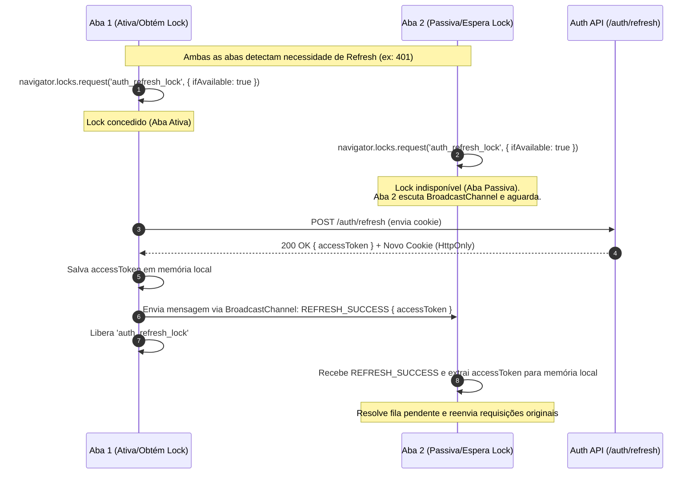

Este documento detalha o ecossistema de autenticação e a topologia de tokens adotada na Aura para garantir segurança contra roubo de sessão (XSS/CSRF), isolamento de cookies em subdomínio dedicado e a mecânica de atualização silenciosa de tokens no frontend.

---

## 1. Topologia de Tokens (Access vs. Refresh)

Para atingir conformidade estrita de segurança (OWASP), a Aura divide as responsabilidades de autorização em dois tokens distintos com escopos e tempos de vida isolados:

1. **Access Token (JWT)**:
   - **Tempo de vida (TTL)**: 15 minutos.
   - **Armazenamento**: Memória local da aplicação (Zustand/React State) no frontend. Nunca é gravado em `localStorage` ou `sessionStorage` para mitigar ataques de Cross-Site Scripting (XSS).
   - **Envio**: Enviado síncronamente via cabeçalho `Authorization: Bearer <token>` em requisições para a API operacional.

2. **Refresh Token (JWT)**:
   - **Tempo de vida (TTL)**: 7 dias (com Rotação Obrigatória a cada uso).
   - **Armazenamento**: Cookie seguro gravado pelo navegador com as flags:
     - `HttpOnly`: Impede a leitura do token via scripts JavaScript (mitigação contra XSS).
     - `Secure`: Transmitido exclusivamente sob conexões HTTPS cifradas.
     - `SameSite=Strict`: Restringe o envio do cookie apenas a requisições originadas do mesmo contexto de domínio (mitigação contra Cross-Site Request Forgery - CSRF).
     - `Path`: Restrito ao escopo do diretório de autenticação (`/auth`) no domínio da API (`api.clinicaexemplo.com.br`).

---

## 2. Diagrama de Fluxo: Login, API e Renovação Silenciosa (RTR)

O diagrama a seguir descreve o ciclo de vida completo do usuário na aplicação: o login inicial, o consumo normal da API com Access Token, a rejeição por expiração (`401`) e o resgate automático de sessão (Silent Refresh) por meio do interceptador HTTP.

```mermaid
sequenceDiagram
    autonumber
    participant Client as Cliente (app.clinicaexemplo.com.br)
    participant Interceptor as Interceptador HTTP
    participant AuthAPI as Auth API (api.clinicaexemplo.com.br/auth)
    participant CoreAPI as Core API (api.clinicaexemplo.com.br/api)
    participant D1 as Banco de Dados (D1/KV)

    Note over Client, AuthAPI: 1. Fluxo de Login Inicial
    Client->>AuthAPI: POST /auth/login { username, password }
    AuthAPI->>D1: Valida credenciais e cria sessão
    D1-->>AuthAPI: OK (Session ID)
    AuthAPI-->>Client: 200 OK { accessToken, user }<br/>Set-Cookie: refreshToken (HttpOnly, SameSite=Strict)

    Note over Client, CoreAPI: 2. Requisições Operacionais Normais
    Client->>CoreAPI: GET /api/agenda [Headers: Authorization: Bearer AccessToken]
    CoreAPI->>CoreAPI: Valida assinatura do JWT (Access Token)
    CoreAPI-->>Client: 200 OK (Dados de Agenda)

    Note over Client, CoreAPI: 3. Expiração do Access Token e Renovação Silenciosa (Silent Refresh)
    Client->>CoreAPI: GET /api/patients [Headers: Authorization: Bearer ExpiredToken]
    CoreAPI->>CoreAPI: Identifica JWT expirado
    CoreAPI-->>Interceptor: 401 Unauthorized (Token Expired)

    rect rgb(35, 20, 50)
        Note over Interceptor, AuthAPI: Interceptador detecta 401, pausa requisições e inicia refresh
        Interceptor->>AuthAPI: POST /auth/refresh (Navegador anexa o Cookie refreshToken automaticamente)
        AuthAPI->>D1: Valida refreshToken e executa Rotação (RTR)
        D1-->>AuthAPI: Nova Sessão Registrada
        AuthAPI-->>Interceptor: 200 OK { accessToken }<br/>Set-Cookie: Novo refreshToken (HttpOnly)
    end

    Note over Interceptor, CoreAPI: 4. Retentativa Automática da Chamada Falhada
    Interceptor->>CoreAPI: GET /api/patients [Headers: Authorization: Bearer NewAccessToken]
    CoreAPI-->>Client: 200 OK (Dados de Pacientes)
```

---

## 3. Mecânica do Interceptador de 401

No frontend, a biblioteca de chamadas HTTP (como Axios ou um wrapper customizado de Fetch) implementa uma fila de requisições pendentes. 

Quando o primeiro erro `401 Unauthorized` com a causa `Token Expired` é capturado:
1. Um sinalizador `isRefreshing` é ativado para evitar disparos múltiplos de refresh em paralelo.
2. Todas as demais requisições operacionais de saída são empilhadas em uma fila de espera (`refreshQueue`).
3. Uma chamada de refresh é feita ao `/auth/refresh` no caminho isolado.
4. Ao receber o novo `accessToken`:
   - Atualiza-se o estado global/memória do frontend.
   - Executa-se todas as requisições represadas na `refreshQueue` com o novo token de acesso no cabeçalho.
   - Desliga-se o sinalizador `isRefreshing`.
5. Se a chamada de refresh falhar (indicando que o Refresh Token de 7 dias também expirou ou foi revogado por reuso), a fila é rejeitada e o usuário é redirecionado para a tela de login (`/auth/login`).

---

## 4. Concorrência Multi-Abas e Sincronização (Web Locks & BroadcastChannel)

A rotação obrigatória de Refresh Tokens (RTR) introduz uma vulnerabilidade operacional se o usuário abrir a aplicação em múltiplas abas:
- Se o Access Token expirar em background, ações simultâneas em abas diferentes podem acionar o processo de Silent Refresh ao mesmo tempo.
- Ambas as abas enviariam o mesmo Refresh Token para `/auth/refresh`. A primeira requisição que o servidor processar rotacionará o token; a segunda enviará um token já invalidado (reusado), acionando o gatilho de segurança do backend e destruindo a sessão inteira do usuário.

Para contornar essa concorrência inter-abas sem abrir mão da segurança dos tokens em memória, a Aura adota uma mecânica de sincronização distribuída no frontend combinando a **Web Locks API** e a **BroadcastChannel API**:

### Funcionamento do Fluxo Sincronizado

### Detalhes de Resiliência:
1. **Safety Timeout**: As abas passivas que aguardam a transmissão do token via `BroadcastChannel` possuem um timeout de segurança (8 segundos). Caso a aba ativa seja fechada ou trave antes de concluir a requisição de refresh, as abas passivas expiram a espera, tentam adquirir o lock e efetuam o refresh de forma autônoma.
2. **Fallback Progressivo**: Em navegadores antigos sem suporte para a Web Locks API, a trava é ignorada e a requisição é enviada diretamente, mantendo a retrocompatibilidade básica de navegação de aba única.
